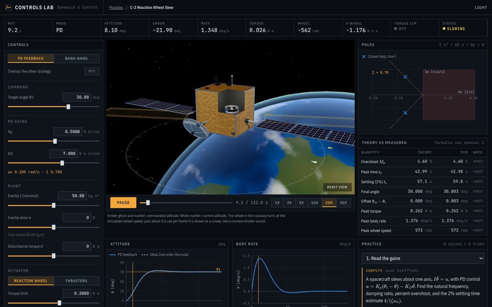
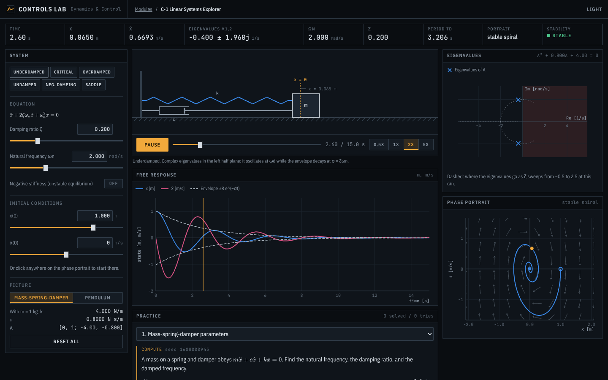

# Controls Lab

An interactive lab for the control theory half of my Dynamics and Control class at CU Boulder. Every lecture gets a module with a simulation, a visual, and practice problems that I work by hand and then check against the sim.

**Live demo: [lishamaganti.com/controls-lab](https://lishamaganti.com/controls-lab/)**  
Made by Lisha Maganti · [lishamaganti.com](https://lishamaganti.com)



## By the numbers

- 2 lecture modules live, 12 more planned (one per lecture)
- 472 automated tests
- 325 reference cases generated with SciPy and python-control that the math library has to match
- 12 practice problem types, each checked over 200 random seeds and played back through the simulator

## Live modules

### C-1 Linear Systems Explorer
Free response of a second order system and what the eigenvalues say about it.
- Sliders for ζ and ωn, a negative stiffness toggle, and initial conditions
- Mass-spring-damper or pendulum drawn from the simulated state
- Eigenvalues on the s-plane with the path they trace as ζ sweeps
- Phase portrait with a direction field and eigenvector lines. Click anywhere to start a new trajectory
- Practice: m, c, k to ωn and ζ, eigenvalues of A, free response at a time, linearizing a pendulum, damper design
- Writeup: [C-1 notes](src/modules/c01-linear-systems/notes.md)



### C-2 Reaction Wheel Slew
Turning a spacecraft about one axis, open loop bang-bang vs PD feedback.
- 3D spacecraft with a reaction wheel cutaway. The wheel spin comes from the simulated wheel speed
- Inertia error, disturbance torque, torque limit, and wheel vs thruster actuation
- Theory vs measured table that flags where the lecture formulas and the sim disagree, and why
- Practice: reading gains, designing to a spec (judged by the sim), planning a bang-bang slew, inertia error, disturbance offset
- Writeup: [C-2 notes](src/modules/c02-reaction-wheel/notes.md)

## Roadmap

| Code | Lecture | Module | Status |
|---|---|---|---|
| C-1 | Oct 13 | Linear Systems Explorer | live |
| C-2 | Oct 15 | Reaction Wheel Slew | live |
| C-3 | Oct 20 | Laplace Workbench | planned |
| C-4 | Oct 22 | Block Diagram Builder | planned |
| C-5 | Oct 27 | Transfer Function Lab | planned |
| C-6 | Oct 29 | Stability Arena | planned |
| C-7 | Nov 3 | Spec Meter | planned |
| C-8 | Nov 5 | Design Challenges | planned |
| C-9 | Nov 10 | Spacecraft Attitude Lab | planned |
| C-10 | Nov 12 | Quadrotor Lab | planned |
| C-11 | Nov 17 | State Space Studio | planned |
| C-12 | Nov 19 | Exam Mode | planned |
| C-13 | Dec 1 | TF to SS Converter | planned |
| C-14 | Dec 3 | Failure Replays | planned |

## How the math is checked

- `src/core` is a small math library with no UI code: polynomial roots, eigenvalues (Francis QR), matrix exponential, transfer functions, state space and conversions between them, exact step/impulse/ramp responses, step metrics, Routh arrays, RK4, partial fractions and inverse Laplace, Pade delay, error constants, Ackermann pole placement, and LQR.
- `verify/gen_golden.py` writes 325 test cases from numpy, scipy, and python-control into `verify/golden/`. The TypeScript tests compare against them, and CI regenerates them on every push and fails if anything drifted.
- Each module tests its sim against the closed-form theory from lecture, and checks physical invariants (wheel momentum bookkeeping, torque limits, energy in the undamped case).
- Every practice problem generator runs over 200 random seeds in the tests, to make sure the hidden answer is right and plays out the same way in the sim.

## Tech stack

TypeScript, React, Vite, Three.js (3D), KaTeX (math), Vitest (tests). Python with SciPy and python-control for the reference data. Plots are hand-built SVG. Everything runs in the browser.

## Running it locally

```
npm install
npm run dev        # local dev server
npm test           # all tests
npm run typecheck  # strict TypeScript
npm run build      # production build into dist/
```

Regenerating the golden files (only needed if the cases change):

```
python -m venv .venv
.venv/bin/pip install -r verify/requirements.txt
.venv/bin/python verify/gen_golden.py
```

## Hosting

The live site is served from my portfolio repo ([lishamaganti-portfolio](https://github.com/lishm31/lishamaganti-portfolio)) on Vercel, under `/controls-lab/`. To update it after a change here:

```
scripts/publish-site.sh    # builds and copies dist/ into ../lishamaganti-portfolio/controls-lab
```

Then commit and push the portfolio repo and Vercel deploys it. CI in this repo (`.github/workflows/ci.yml`) runs the typecheck, tests, build, and golden drift check on every push.
